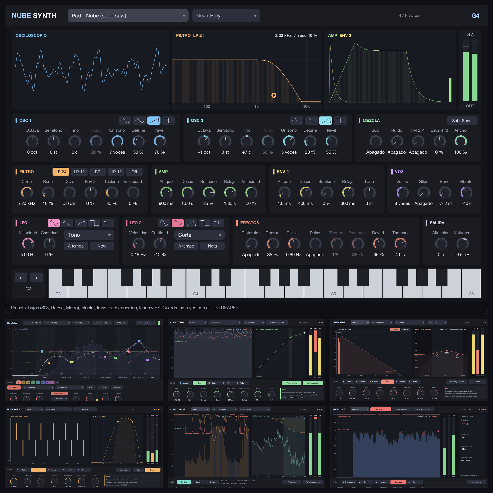

# Nube plugins

Seven free audio plugins for [REAPER](https://www.reaper.fm) (JSFX, macOS / Windows / Linux): a synthesizer and a
full mixing chain. Built with [Claude Code](https://claude.com/claude-code) for my own songs.



| Plugin | What it is |
|---|---|
| [Nube Synth](https://github.com/KevinMeneses/nube-synth) | Polyphonic synth: 2 anti-aliased oscillators with 7-voice unison, sub, noise, FM, filter, 2 envelopes, 2 LFOs, glide (808 slides), FX, 22 presets |
| [Nube EQ](https://github.com/KevinMeneses/nube-eq) | 16-band parametric EQ with M/S, dynamic bands, sidechain and analyzer |
| [Nube Comp](https://github.com/KevinMeneses/nube-comp) | Compressor with 5 styles, saturation, M/S, sidechain and lookahead |
| [Nube Verb](https://github.com/KevinMeneses/nube-verb) | Algorithmic reverb (16-line FDN), 6 spaces, ducking, shimmer, freeze |
| [Nube Delay](https://github.com/KevinMeneses/nube-delay) | Delay: digital, tape, analog, lo-fi, diffuse; tempo sync, ping-pong, ducking |
| [Nube De-Ess](https://github.com/KevinMeneses/nube-deess) | De-esser with relative detection and phase-aligned split band |
| [Nube Limit](https://github.com/KevinMeneses/nube-limit) | Brickwall limiter with 4x true peak and a BS.1770 LUFS meter |

## Install

With [ReaPack](https://reapack.com): **Extensions → ReaPack → Import repositories…** and paste

```
https://github.com/KevinMeneses/nube-plugins/raw/main/index.xml
```

Then **Extensions → ReaPack → Browse packages**, search "Nube" and install. They show up as **JS: Nube …** in the FX
browser. The interfaces are in Spanish; hover any control to see what it does.

## How they were made

I'm a mobile engineer, not a DSP engineer. I designed these with Claude Code, and since an AI can't listen, every
feature is checked by rendering test cases inside REAPER and comparing them with the math: filter curves against the
bilinear transform, tuning to ±0.01 Hz, envelope times, FM sidebands against Bessel functions, echo positions to the
sample, reverb RT60, loudness against BS.1770. About 330 renders and 400+ automated checks across the seven, plus
mouse-driven UI tests. Each repo has its tests under `tests/`.

## License

GPL-3.0-or-later. `make_index.py` regenerates `index.xml` from the plugin repos (commit-pinned sources).

---

## Español

Siete plugins gratis para REAPER: un sintetizador y una cadena de mezcla completa (EQ, compresor, reverb, delay,
de-esser y limitador), hechos con Claude Code para mis canciones. Se instalan con ReaPack pegando la URL de arriba en
**Extensions → ReaPack → Import repositories…**. Cada plugin se verifica renderizando casos de prueba dentro de REAPER
y comparándolos con la teoría.
